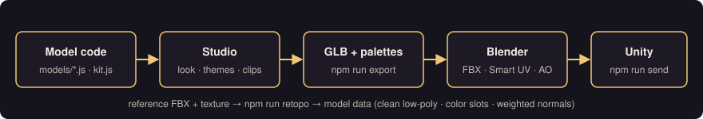

# VoxPoly Studio

**English** · [ภาษาไทย](README.th.md)

Build game-ready **low-poly models in code** (three.js), check them in the browser, and export them to **FBX for Unity** —
with color themes, Smart-UV textures, soft/hard edges, simple bone animation, and tools to **learn topology from reference models**.
New in 2.5: **copy a rigged FBX character into three.js exactly, reshape it with sliders and save the result as presets** — plus cel shade for any scene.



## What you get

| | |
|---|---|
| **Model Studio** (`index.html`) | Orbit / ortho views, wireframe, scale hand + ruler, color themes, texture & UV panel, play animation clips, open the exported FBX to compare |
| **Model Kit** (`models/kit.js`) | Write a model as code: loft, boxes/cylinders, thick plates (`slab.js`), soft edges, rigid-skin bones, palette colors (1 mesh · 1 material) |
| **Export to Unity** (`npm run export`) | GLB → FBX (meters, Y-up, no leftover rotation) · textures per theme · Smart UV + baked textures + AO + UV layout · rigged models → avatar + one FBX per clip, auto-checked |
| **Hand-off folder** (`npm run send`) | Clean `<Set>_SEND/` with FBX, Animations/, Textures/, UVLayout/, Preview/ |
| **FBX Viewer** (`viewer.html`) | Open animated FBX from `workspace/fbx/`, play / scrub clips, graph the height and speed of any bone, see sound cues |
| **Motion & sound tools** (`npm run motion`, `npm run cues`) | Read an FBX animation as numbers, re-use it on your own three.js model (`models/motion.js`), find footstep / swing / roar moments and play sounds on them (`models/cue_player.js`) |
| **FBX Clone** (`clone.html`, `npm run clone`) | Copy a rigged FBX + clips into three.js — every vertex, face, UV, weight and frame, verified against Blender to ~0.01 mm · see the real edge flow · **17 proportion sliders** (head, limbs, girth…) that work on any rig naming · **presets** · UV tools for artists · export GLB with rig + clips |
| **Cel shade** (`models/toon.js`) | One call gives a whole scene cartoon light steps + outlines (skinned characters included) · adjustable steps / shadow / outline |
| **Render cost meter** (`models/perf.js`) | Draw calls · triangles · fps on every page, against a VR budget |
| **Topology tools** (`npm run retopo`, `tools/topo/`) | Measure wasted edges / skinny triangles / distance to a reference · rebuild a textured reference as clean low-poly with color slots and weighted normals |
| **Docs** (`docs/`) | Modeling, export, topology, animation and sound-sync knowledge — in English and Thai |

## Quick start

1. Install **Node 18+**, **Python 3.10+**, **Blender 4.2+**, and **Chrome** (or Chromium / Edge).
2. Clone and set up:
   ```bash
   git clone https://github.com/AoWallop/voxpoly-studio-AO.git
   cd voxpoly-studio-AO
   pip install -r requirements.txt
   cp .env.example .env          # then fill in BLENDER and CHROME paths
   npm run doctor                # checks everything
   ```
3. Open the studio:
   ```bash
   npm run serve                 # → http://localhost:8129/
   ```
4. Export a sample:
   ```bash
   npm run export -- sample_sword
   npm run send -- Samples
   ```

Full guide: [docs/en/getting-started.md](docs/en/getting-started.md)

## Make your own models

Copy `workspace.example/` to `workspace/` and put your models there. `workspace/`, `ref/` and `export/` are **git-ignored**:
your files are never uploaded and `git pull` never overwrites them. See [docs/en/modeling-kit.md](docs/en/modeling-kit.md).

## Updating

```bash
git pull
```
Then read [CHANGELOG.md](CHANGELOG.md) for what changed. If a new version adds a folder to `workspace.example/`, create it in your `workspace/` too.

## Using with Claude Code

This repo includes [CLAUDE.md](CLAUDE.md) — a working guide for Claude Code (how to build, check and export models here).
Open the folder in Claude Code and ask for a model; it will follow the same pipeline.

## Docs

- [Getting started](docs/en/getting-started.md)
- [Model Kit](docs/en/modeling-kit.md)
- [Export to Unity](docs/en/export-unity.md)
- [Topology](docs/en/topology.md)
- [Animation from FBX](docs/en/animation.md)
- [Sound that follows animation](docs/en/sound-sync.md)
- [FBX Clone — exact copy, proportions, presets](docs/en/fbx-clone.md)
- [Cel shade and render cost](docs/en/look-and-performance.md)

## License

MIT — see [LICENSE](LICENSE). Free to use, change and ship in your own projects; keep the copyright notice.
